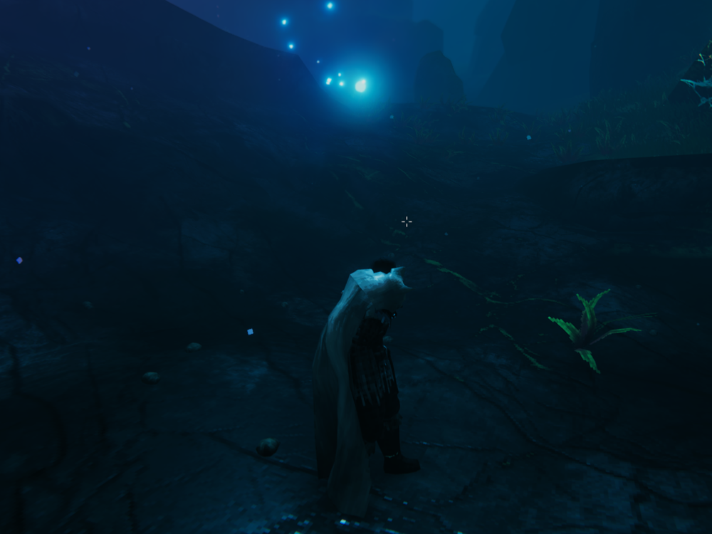
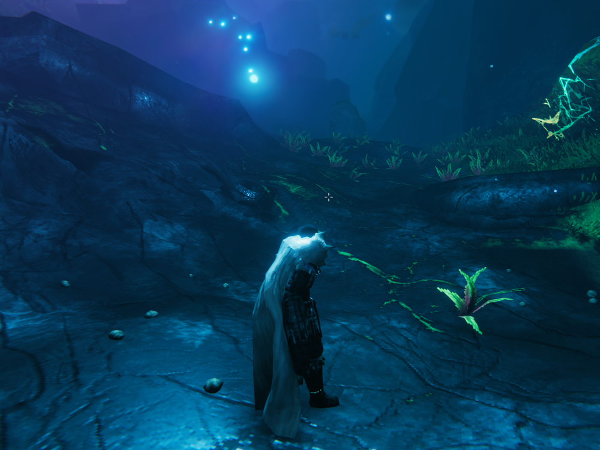

<p align="center">
  
</p>

<h1 align="center">Brighter Wisplight</h1>

<p align="center">
  <b>The Wisplight, finally bright enough to see by.</b><br>
  A small Valheim comfort mod: more light and reach, nothing else.
</p>

<p align="center">
  <a href="https://thunderstore.io/c/valheim/p/TaKeShI/BrighterWisplight/"><b>Download on Thunderstore</b></a>
  &nbsp;·&nbsp;
  <a href="thunderstore/CHANGELOG.md">Changelog</a>
  &nbsp;·&nbsp;
  <a href="thunderstore/README.md">Full docs</a>
</p>

---

The Wisplight pushes back the Mistlands fog, but it barely lights anything —
you still walk in the dark with one hand busy. This mod makes its light reach
far enough to see where you step.

## Before / after

Same spot, same night, same Wisplight. Only the light changed.

| Vanilla | With Brighter Wisplight |
| :---: | :---: |
|  |  |

The **fog is untouched**: the mist-clearing bubble is exactly vanilla size.
What changes is how far the light reaches *through* the mist.

## Highlights

- **Light only.** No new items, recipes, colors or fog changes.
- **Range over glare.** Defaults barely touch brightness and are generous with
  reach — the way to see more without blowing out the screen.
- **Tight limits on purpose.** A comfort tweak, not a floodlight.
- **Live config.** Change it in game (F1 with ConfigurationManager); applies
  instantly.
- **Client-side.** Not needed on the server or by other players.
- **Plays nice** with fog mods such as MistBeGone.

## Install

With **Thunderstore Mod Manager** or **r2modman**: search for
*Brighter Wisplight* and install.

Manually: copy `BrighterWisplight.dll` into `BepInEx/plugins`
(requires [BepInExPack Valheim](https://thunderstore.io/c/valheim/p/denikson/BepInExPack_Valheim/)).

## Configuration

`BepInEx/config/com.pass-os.brighterwisplight.cfg`, created on first launch.

| Option | Default | What it does |
| --- | --- | --- |
| `Enabled` | `true` | Master switch; off restores the original values |
| `IntensityMultiplier` | `1.13` | Brightness. `1` = vanilla, max `1.5` |
| `RangeMultiplier` | `4.4` | How far the light reaches. `1` = vanilla, max `5` |
| `CastShadows` | `false` | Real shadows. Looks great, costs FPS |
| `SkipCreatures` | `true` | Leaves Hugin, Munin and Mistwalker alone |
| `NameFilter` | empty | Narrow down which wisps are affected |
| `VerboseLogging` | `false` | Logs every affected wisp with before/after values |

Why the color can't be changed, torch-style setups and filtering only the
carried wisp: see the [full docs](thunderstore/README.md#configuration).

## Build from source

Needs the .NET SDK (the mod targets `net472`) and Valheim installed.

```powershell
dotnet build -c Debug     # builds and copies the dll to the mod manager profile
dotnet build -c Release   # builds dist/BrighterWisplight-<version>.zip for Thunderstore
```

The game folder is detected on the usual Steam paths. If yours is elsewhere,
copy `Environment.props.example` to `Environment.props` (ignored by git) and
set `ValheimDir` and `ModDeployDir`.

### Releasing

1. Bump `<Version>` in `BrighterWisplight.csproj` and `version_number` in
   `thunderstore/manifest.json` (same number).
2. Add the entry to `thunderstore/CHANGELOG.md`.
3. `dotnet build -c Release`, then upload `dist/BrighterWisplight-<version>.zip`
   at [thunderstore.io](https://thunderstore.io/c/valheim/create/) under the
   **TaKeShI** team.
